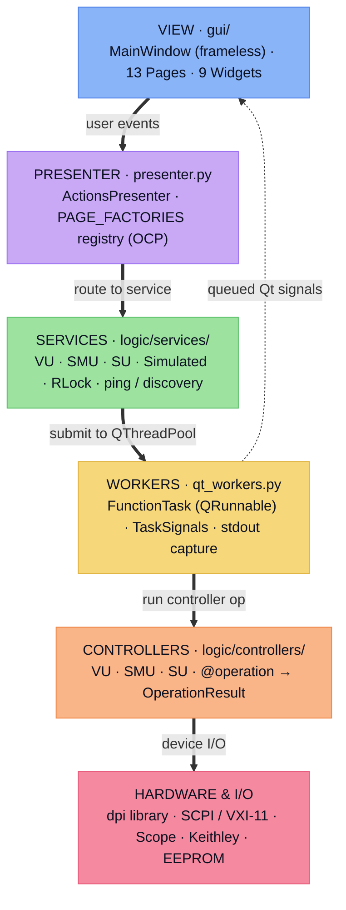
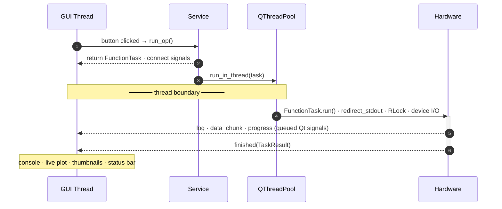
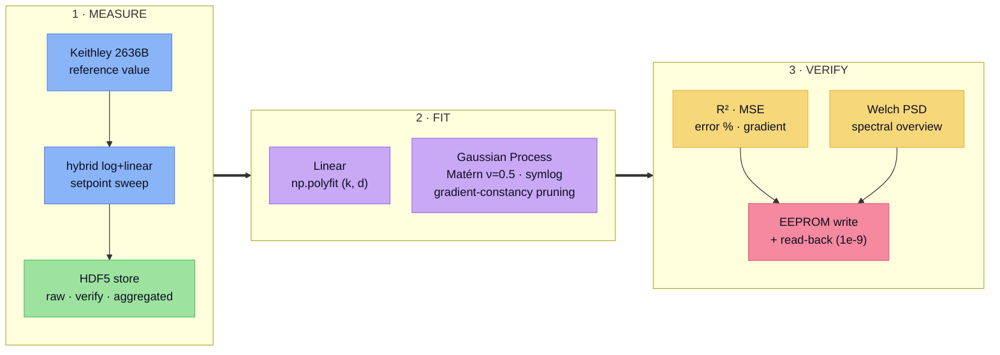
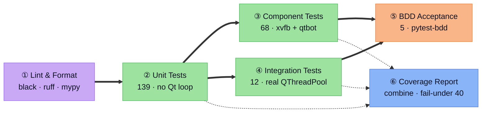

<div align="center">

# HardwareGUI

### A responsive desktop control & calibration suite for DPI semiconductor test instruments

[](https://www.python.org/downloads/)
[](https://doc.qt.io/qtforpython/)
[](tests/)
[](pyproject.toml)
[](https://docs.astral.sh/uv/)
[](https://docs.astral.sh/ruff/)
[](https://github.com/psf/black)
[](https://pre-commit.com/)

**Bachelor thesis project - Institute for Microelectronics, TU Wien**

~18k lines of Python · 79 modules · MVP + layered services · fully threaded · 342 automated tests

[Highlights](#engineering-highlights) · [Architecture](#architecture) · [Instrumentation](#hardware--instrumentation) · [Calibration](#calibration--signal-processing) · [Testing](#testing) · [Quick Start](#quick-start)

</div>

---

## What this is

Bench calibration of DPI test hardware is a long, error-prone sequence of manual steps spread across three instrument families - set a voltage, trigger a scope acquisition, read back coefficients, fit a correction curve, write EEPROM, repeat per channel and per range. Done through bare scripts it offers no feedback during minutes-long acquisitions, no artifact bookkeeping, and no graceful recovery when a trigger times out halfway through.

**HardwareGUI** wraps that entire pipeline in a single Qt desktop application. Every hardware operation runs on a worker thread with live console streaming, real-time plots, structured artifact collection, and cooperative cancellation - while the UI stays responsive. The same binary runs against physical instruments **or** a built-in simulation backend, so the full interface can be developed and demonstrated with no lab present.

| | Bare scripts | HardwareGUI |
|:---|:---|:---|
| **Calibration run** | manual invocation, copy-pasted parameters | one click; automated measure → fit → verify with live plots |
| **Long operations** | blind wait, no output until done | streamed stdout, progress, per-range timing, **Cancel** button |
| **Errors** | crash, lost state | typed exceptions → structured results, status bar, safe rollback |
| **Artifacts** | save/rename plots by hand | timestamped auto-collection + thumbnail gallery + viewer |
| **Finding instruments** | hard-coded IPs, hope it pings | parallel `*IDN?` network discovery + ping verification |
| **No hardware?** | nothing runs | `--simulation` drives the whole UI |

---

## Engineering Highlights

The parts worth reading the source for.

### Concurrency that never blocks the UI
- **`FunctionTask(QRunnable)` on a global `QThreadPool`** - every device operation executes off the GUI thread and returns an immutable `TaskResult`. Cancellation is cooperative via a `threading.Event` surfaced to the page as a Cancel button. *(`src/logic/qt_workers.py`)*
- **Live stdout/stderr capture.** A line-buffered `_EmittingStream(io.TextIOBase)` wraps each task in `redirect_stdout`/`redirect_stderr`, so any `print()` deep inside an instrument routine streams into the GUI console - delivered across threads by Qt's auto-queued signals, with **no manual locking** in the pages.
- **Thread-correct matplotlib.** Workers force the headless `Agg` backend so off-thread figure generation never touches the GUI toolkit; only the embedded `QtAgg` canvases run on the UI thread.
- **Guarded hardware access.** A re-entrant `threading.RLock` serializes device I/O, and a `require_instrument_ip` decorator *rewrites the task's job* to run `_ensure_connected()` inside the worker - connection setup never freezes the event loop. *(`src/logic/services/base_service.py`)*

### Architecture built for extension
- **Open/Closed page registry.** `PAGE_FACTORIES: dict[str, (factory, service_type)]` maps a page id to a factory closure - adding a screen is one dictionary entry, zero `if/elif`. *(`src/logic/presenter.py`)*
- **Structural-typing contracts.** `@runtime_checkable` `Protocol`s (`ConnectableService`, `MeasurementCapable`, `CalibrationCapable`) define what each page needs from its service, checked statically by mypy without inheritance. *(`src/logic/protocols.py`)*
- **Result/Either error model.** Every controller method is wrapped by an `@operation` decorator written with **PEP 695 type-parameter syntax** (`def operation[F: Callable[..., Any]](func: F) -> F`); it converts any exception into a frozen `OperationResult(ok=False, ...)` so exceptions never cross the controller boundary. *(`src/logic/controllers/base_controller.py`)*
- **Typed exception hierarchy** - `HardwareError → ConnectionError → DeviceNotFoundError`, `CommunicationError → ScopeTimeoutError`, `CalibrationError`, `ConfigurationError`. *(`src/logic/exceptions.py`)*
- **Configuration as nested frozen dataclasses** with environment-variable overrides, one immutable singleton. *(`src/config.py`)*

### Instrumentation done at the protocol level
- **SCPI over raw TCP and VXI-11**, with hand-rolled **IEEE-488.2 definite-length binary block** decoding (`np.frombuffer(..., dtype=np.single)`) for oscilloscope waveform capture and VXI-11 **link teardown/recovery** after a stale trigger. *(`src/logic/controllers/vu_controller.py`)*
- **Reference metrology** against a **Keithley 2636B** SourceMeter (TSP/Lua) and a Rohde&Schwarz-class scope.
- **EEPROM coefficient programming with read-back verification** to 1e-9, plus a convergence-gated auto-calibration loop that alternates ramp-slope and offset passes.
- **Parallel network discovery** - a 64-thread `ThreadPoolExecutor` sweeps the local /24 for SCPI (`:5025`) and VXI-11 (`:111`) endpoints and identifies them via `*IDN?`. *(`src/logic/network_discovery.py`)*

### Calibration as real signal processing
- **Gaussian-Process and linear models.** Least-squares (`np.polyfit`) and scikit-learn `GaussianProcessRegressor` with a **Matérn (ν=0.5) kernel**, **symlog companding** to condition data spanning many decades (pA→mA), and a **gradient-constancy test** that prunes the symlog kink so the fitted transfer function preserves constant gain. Quality scored by **R² / MSE**; **Welch PSD** spectral overviews. *(`src/logic/calibration/`, `src/logic/controllers/su_controller.py`)*

### UI craft
- **Frameless, translucent `QMainWindow`** with a drop-shadow, native `startSystemMove()` dragging (manual fallback), and custom min/max/close chrome. *(`src/gui/main_window.py`)*
- **Hover-intent sidebar** animating `minimumWidth`, with a custom `paintEvent` that bypasses Qt's text eliding for clean label slide; IDE-style collapsible terminal & artifact panels; **flicker-free per-hardware panel swapping** via permanent `QStackedWidget` residents. *(`src/gui/widgets/`)*
- **Real-time plotting** - `FigureCanvasQTAgg` widgets fed by `data_chunk` signals; batch mode auto-switches to line-only rendering for 50k-point waveforms; debounced resize/refit. *(`src/gui/widgets/live_plot_widget.py`)*
- **Throughput-aware rendering** - 50 ms batched ANSI→HTML console, `QFileSystemWatcher` artifact thumbnails (500 ms debounce), and a tooltip warm/cold/grace-period state machine.
- **Model/View** - custom `QAbstractListModel` + `QSortFilterProxyModel` with five roles; per-hardware state (last action, console log, connection status) persisted across three singletons.

---

## By the numbers

| | |
|:---|:---|
| **Application code** | ~18,000 lines across **79** Python modules (excl. generated Qt resources) |
| **View layer** (`src/gui/`) | 9,187 lines · 42 modules · 9 custom widgets · 13 hardware pages |
| **Logic layer** (`src/logic/`) | 8,168 lines · 28 modules · 3 controllers · 6 services |
| **Tests** | **342** automated tests · 5,303 lines · 5 layers · green in **~5 s** |
| **Instrument families** | 3 (Voltage Unit, Source Measure Unit, Sampling Unit) |
| **CI** | 6-stage GitHub Actions DAG · headless Qt under `xvfb` |
| **Quality gates** | Black · Ruff · mypy · pytest - enforced via pre-commit |

---

## Architecture

The application is **Model-View-Presenter (MVP)** over a layered service stack that keeps hardware I/O, threading, and UI concerns strictly separated. Each layer below is one band; solid edges carry commands downward, the dashed edge carries results back as **queued Qt signals**.



### Layer responsibilities

| Layer | Location | Responsibility |
|:---|:---|:---|
| **View** | `gui/` | Renders UI and captures input. Every hardware page subclasses `BaseHardwarePage`, inheriting task lifecycle, busy-state gating, artifact watching, and config-driven layout factories. |
| **Presenter** | `logic/presenter.py` | Routes view events to services. The `PAGE_FACTORIES` registry binds page ids → factory closures (Open/Closed Principle). |
| **Hardware services** | `logic/services/` | Own connection lifecycle and threading. `BaseHardwareService` provides signals, an `RLock`, IP verification/ping, network discovery, and the `require_instrument_ip` guard. |
| **Controllers** | `logic/controllers/` | Pure hardware logic - no threading, no Qt. Each public method is wrapped by `@operation` and returns a frozen `OperationResult`. |
| **Workers** | `logic/qt_workers.py` | `FunctionTask` (`QRunnable`) wraps a callable with stdout capture, cooperative cancellation, and a rich `TaskSignals` bus (`started/log/progress/artifact/data_chunk/finished/error/cancelled`). |
| **Model / Config** | `logic/model/`, `config.py` | `QAbstractListModel` + proxy for the action list; nested frozen-dataclass configuration with env overrides. |

### Threading & signal flow

Hardware work runs on `QThreadPool` workers; results return to the UI exclusively through queued Qt signals - the GUI thread never blocks and never touches a device handle directly.



### Simulation mode

`SimulatedVoltageUnitService`, `SimulatedSMUService`, and `SimulatedSUService` extend `BaseHardwareService` directly and are **dependency-injected** into the presenter (`main.py --simulation`). They reproduce each real service's public API - emitting timestamped console output, streaming `data_chunk` points into the live plots, and generating matplotlib artifacts - so the entire UI, threading model, and plotting pipeline run with **no instruments attached**. *(`src/logic/simulation.py`)*

---

## Hardware & Instrumentation

Three instrument families, each exposed through a Connection → Setup → Test → Calibration page flow (the Voltage Unit adds a Guard page).

<table>
  <thead>
    <tr><th align="left">Instrument</th><th align="left">Domain operations</th><th align="left">Pages</th></tr>
  </thead>
  <tbody>
    <tr>
      <td><strong>Voltage Unit</strong></td>
      <td>Session &amp; EEPROM coefficient management, output / ramp / transient (MSM) tests with oscilloscope capture, Python and on-board calibration, guard-signal control</td>
      <td>Connection · Setup · Test · Calibration · Guard</td>
    </tr>
    <tr>
      <td><strong>Source Measure Unit</strong></td>
      <td>Device init, transimpedance (IV-converter) and post-amp relay routing, high-pass &amp; VGUARD control, saturation detection/clear, EEPROM calibration over the IV × PA × VSMU range matrix</td>
      <td>Connection · Setup · Test · Calibration</td>
    </tr>
    <tr>
      <td><strong>Sampling Unit</strong></td>
      <td>Device init, single-shot / transient / pulse acquisition, MCU sync &amp; trigger control, channel configuration, multi-decade calibration sweeps</td>
      <td>Connection · Setup · Test · Calibration</td>
    </tr>
  </tbody>
</table>

**Protocols & references.** SCPI is spoken over both raw TCP sockets and VXI-11; scope waveforms arrive as IEEE-488.2 definite-length binary blocks parsed by hand into `numpy` arrays. The reference instrument is a **Keithley 2636B** SourceMeter driven over VXI-11 with TSP/Lua commands; the oscilloscope path includes explicit `*OPC?` trigger synchronization and VXI-11 link recovery. The application integrates with the institute's **`dpi`** instrument library, which the controllers wrap and the calibration layer extends.

---

## Calibration & Signal Processing

Calibration is the scientific core. The workflow is **measure → fit → verify**, streamed live to the operator:



1. **Measure.** A hybrid log+linear setpoint sweep is applied; the reference value comes from the Keithley, the device-under-test is sampled (transient acquisition), and each point is captured as a `pandas` frame carrying rich metadata (set/ref values, channel, range, and **both board temperatures** for drift context). Data is persisted incrementally to **HDF5** (`h5py`), separating raw, verification, and aggregated stores.
2. **Fit.** Two model families are available:
   - **Linear** - degree-1 ordinary least squares (`np.polyfit`) producing slope/offset `(k, d)`.
   - **Gaussian Process** - scikit-learn `GaussianProcessRegressor` with a **Matérn (ν=0.5)** kernel over **symlog-companded** inputs/outputs, so data spanning many decades is well-conditioned. An iterative fit runs a **gradient-constancy check** (`np.gradient` over a dense grid) and prunes the symlog kink near zero until the calibrated transfer function has constant gain - physically guaranteeing the calibration doesn't distort the signal.
3. **Analyze & verify.** Each model is scored with **R²** and **MSE** (`sklearn.metrics`), error / error-% / gradient diagnostics are rendered at 300 dpi, and a **Welch PSD** (`scipy.signal.welch`) overview is produced. Fitted models are hashed (SHA-256) and written into the device EEPROM with read-back verification.

A `CalibrationProgressAdapter` **duck-types `tqdm`** so the `dpi` library's internal measurement loop transparently drives GUI callbacks - emitting per-point data and per-range start/done events (with wall-clock timing) that feed the live plots and progress UI.

> The heavy numerics build on the institute's `dpi` calibration framework; this repository contributes the device-specific model configuration (kernel, scaling, score/gradient thresholds, range geometry) via template-method subclasses, the acquisition/measurement orchestration, the controllers, and the full GUI + threading layer around it.

---

## Project Structure

```
HardwareGUI/
├── src/
│   ├── main.py                     # Entry point - argparse, --simulation, DI of services
│   ├── config.py                   # Nested frozen-dataclass configuration (env overrides)
│   ├── logging_config.py           # App logging (distinct from the GUI console stream)
│   ├── populate_items.py           # Static hardware + action descriptors
│   ├── gui/                        # ── View layer (9.2k LOC) ───────────────
│   │   ├── main_window.py          #   Frameless QMainWindow + custom chrome
│   │   ├── scripts/                #   13 hardware pages over BaseHardwarePage
│   │   │   ├── base_page.py        #     Task lifecycle, layout factories, artifact watch
│   │   │   ├── voltage_unit/       #     5 pages   source_measure_unit/  4 pages
│   │   │   └── sampling_unit/      #     4 pages
│   │   ├── widgets/                #   9 widgets: live/analysis plots, sidebar,
│   │   │                           #     collapsible panels, stacked router, …
│   │   ├── services/               #   StatusBar / SharedPanels / Tooltip singletons
│   │   ├── mixins/ · utils/        #   Animation mixins, ANSI→HTML, file watcher, viewer
│   │   └── styles.py               #   Centralized dark theme (single-source palette)
│   └── logic/                      # ── Logic layer (8.2k LOC) ───────────────
│       ├── presenter.py            #   MVP presenter + PAGE_FACTORIES registry
│       ├── qt_workers.py           #   FunctionTask / TaskSignals / stdout capture
│       ├── protocols.py            #   Structural-typing page↔service contracts
│       ├── exceptions.py           #   Typed hardware exception hierarchy
│       ├── network_discovery.py    #   Parallel *IDN? instrument scan
│       ├── simulation.py           #   Simulated services for --simulation
│       ├── controllers/            #   VU / SMU / SU pure hardware logic + @operation
│       ├── services/               #   Hardware service layer (threading, lifecycle)
│       ├── calibration/            #   Device-specific GP / linear model subclasses
│       └── model/                  #   QAbstractListModel + proxy
├── tests/                          # 342 tests - unit · component · integration · bdd
├── .github/workflows/test.yml      # 6-stage CI pipeline
├── .pre-commit-config.yaml         # black · ruff · mypy · pytest hooks
├── run.sh                          # Launcher (activates DPI venv, sets PYTHONPATH)
└── pyproject.toml                  # Deps + ruff/black/mypy/pytest/coverage config
```

---

## Testing

A genuine multi-layer pyramid - **342 tests, all passing in ~5 seconds** headless.

| Layer | Tests | Scope | How it runs |
|:---|---:|:---|:---|
| **Unit** | 139 | Controllers, workers, config, network discovery | Synchronous, no Qt loop |
| **Component** | 68 | Qt widgets & pages | `qtbot`, real Qt event loop |
| **Integration** | 12 | service → controller → **real `QThreadPool`** | `qtbot.waitSignal`, thread-pool drain on teardown |
| **BDD** | 5 | Gherkin acceptance scenarios | `pytest-bdd` |
| **Service / model** | 118 | Pre-existing service, model & helper suites | Synchronous |

**What makes the suite robust:**
- **Hardware mocked at import time** - `tests/conftest.py` injects `MagicMock` modules for the `dpi`/`vxi11` packages into `sys.modules` *before* `src` is imported, so the suite runs anywhere, no drivers required.
- **A realistic instrument simulator** - the scope mock synthesizes a valid **IEEE-488.2 binary waveform block** and answers SCPI `*IDN?`/`*OPC?` queries via a `side_effect` table, so the binary-parsing path is exercised for real.
- **Qt signals on mocks** - mock services are `QObject` subclasses with *real* `Signal`s, so `qtbot.waitSignal()` works and signal **ordering** (`started → log → finished`) is asserted explicitly.
- **Behavior specs** - `pytest-bdd` features written in Gherkin (`Given/When/Then`) with parametrized steps and shared fixture state.
- **DRY mock factories** (`create_mock_device`) and layered `conftest.py` scoping; `--strict-markers` enforced.

```bash
uv run pytest                       # everything (342)
uv run pytest tests/unit -m unit    # by layer
uv run pytest --cov=src --cov-report=term-missing
```

### CI pipeline

GitHub Actions runs a six-stage dependency graph; component, integration, and BDD stages render Qt headlessly under `xvfb` / `QT_QPA_PLATFORM=offscreen`, and coverage from the three measured jobs is combined into one gated report.



---

## Development

### Quality gates

Every commit is gated by [pre-commit](https://pre-commit.com/) hooks; CI re-runs the same checks.

| Tool | Role | Notes |
|:---|:---|:---|
| **Black** | Formatting | line length 100, `py312` |
| **Ruff** | Linting | `E,W,F,D,UP,B,SIM` rule families, Google docstring convention |
| **Mypy** | Static typing | `py312`, `check_untyped_defs`, layered per-module strictness |
| **pytest** | Tests | pre-commit runs the unit layer; CI runs all five |

```bash
uv run pre-commit install        # one-time
uv run black --check src/ tests/
uv run ruff check src/ tests/
uv run mypy src/
```

### Adding a new instrument

The layering makes a new device almost mechanical:

1. **Controller** in `logic/controllers/` - pure hardware logic; decorate methods with `@operation`, return `OperationResult`.
2. **Service** in `logic/services/` - subclass `BaseHardwareService`; implement `_ensure_connected` / `_disconnect` / `_artifact_dir`.
3. **Pages** in `gui/scripts/<device>/` - subclass `BaseHardwarePage` for task lifecycle and layout factories for free.
4. **Register** the pages in `PAGE_FACTORIES` (`presenter.py`) - one dict entry each.
5. **Describe** the hardware and actions in `populate_items.py`.

No existing `if/elif` needs editing - that's the Open/Closed registry paying off.

---

## Quick Start

### Prerequisites
- **OS:** Linux (X11 or Wayland)
- **Python:** 3.12+ · the [`uv`](https://docs.astral.sh/uv/) package manager
- **For real hardware:** the institute `dpi` library and lab-network access to the instruments (the launcher activates the DPI virtualenv and sets `PYTHONPATH`). *Simulation mode needs neither.*

### Set up & test (no hardware required)

```bash
git clone https://github.com/Konoszaf1/HardwareGUI.git
cd HardwareGUI
uv sync --dev          # create the venv and install all dependencies
uv run pytest          # 342 tests, ~5 s
```

### Run the application

```bash
./run.sh               # against physical instruments
./run.sh --simulation  # full UI, no hardware
```

> Use `run.sh` rather than launching `python` directly - it activates the lab DPI virtualenv (`/measdata/dpi/venv/dpi`), syncs `requirements-gui.txt`, exports `PYTHONPATH`, and starts `src/main.py` so the `dpi` package and Qt resources resolve. Set `LOG_LEVEL=DEBUG` for verbose diagnostics.

### Troubleshooting

| Symptom | Fix |
|:---|:---|
| `ModuleNotFoundError: No module named 'dpi'` | Launch via `./run.sh` (or use `--simulation`); don't run `python src/main.py` directly |
| `qt.qpa.plugin: could not load the Qt platform plugin` | `sudo apt install libxcb-cursor0 libxkbcommon-x11-0 libegl1 libgl1` |
| Permission denied on a script | `chmod +x run.sh scripts/*.sh` |

---

## Academic Context & License

Developed as a **bachelor thesis** at the **Institute for Microelectronics, TU Wien**, around the institute's `dpi` instrument framework. No open-source license is currently declared; usage and distribution are subject to the institute's terms. *(Add a `LICENSE` file if releasing publicly.)*
